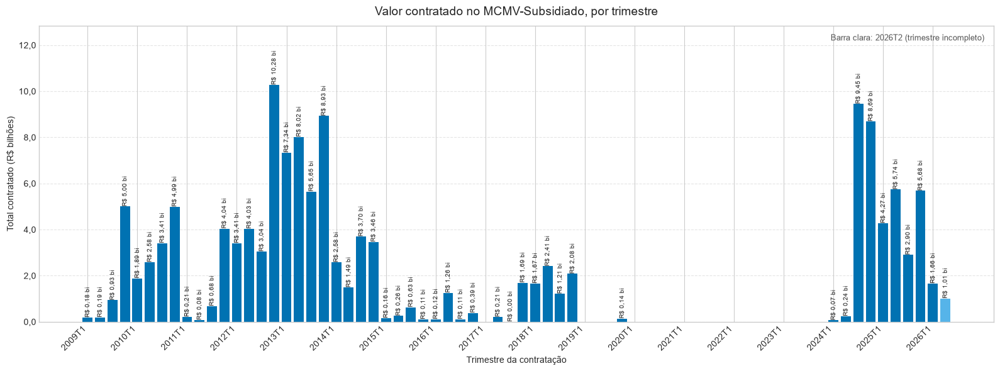
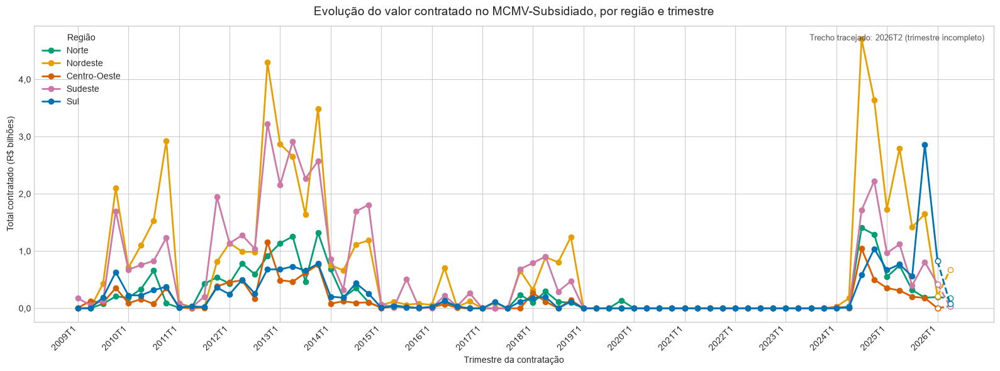
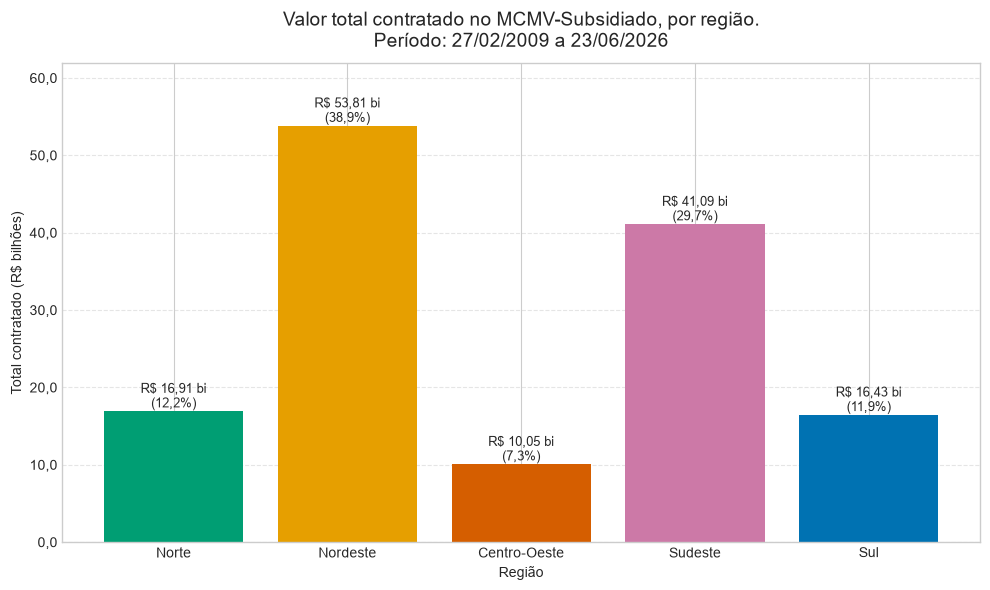
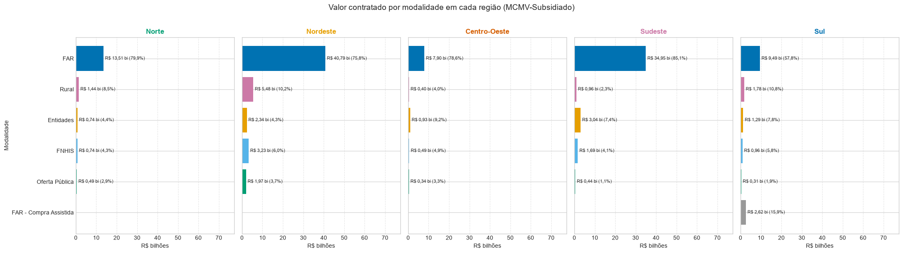
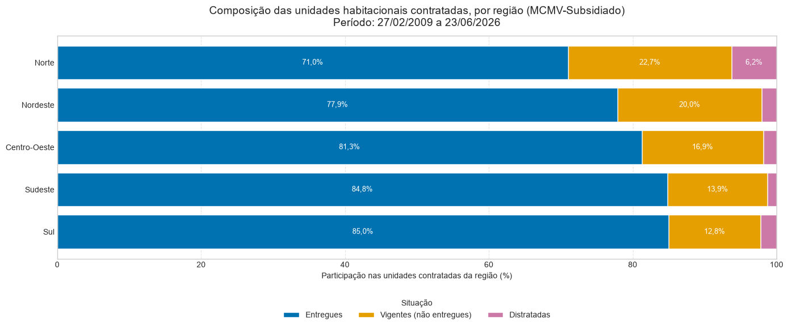

# Projeto Habitação MCMV: análise do Minha Casa, Minha Vida (MCMV-Subsidiado)

Análise exploratória dos empreendimentos contratados no MCMV, modalidade subsidiada, a partir das bases abertas do Ministério das Cidades (Secretaria Nacional de Habitação, SNH). O projeto tem dois objetivos: entender **onde e quando** as contratações acontecem (análise territorial) e avaliar **a participação das empresas** responsáveis pelos empreendimentos (fase 2).

**Fonte dos dados:** [Bases de dados do Programa Minha Casa, Minha Vida (gov.br/cidades)](https://www.gov.br/cidades/pt-br/acesso-a-informacao/acoes-e-programas/habitacao/programa-minha-casa-minha-vida/bases-de-dados-do-programa-minha-casa-minha-vida)

**Dicionário de dados:** *Dicionários de Dados SNH*, versão 2.4, de 09/10/2025 (arquivo em `documentacao/`).

## Estrutura do projeto
```text
mcmv/
├── dados/
│   ├── brutos/          # arquivos originais, sem alteração (não versionados)
│   └── tratados/        # saídas geradas pelo código (não versionadas)
├── documentacao/        # dicionários de dados em PDF
├── figuras/             # gráficos exportados
├── notebooks/
│   ├── 01_carregamento.ipynb
│   ├── analise_mcmv_subsidiado.py   # análise territorial e de unidades
│   └── mcmc_subsidiados_empresas.py # desempenho das empresas (fase 2)
├── src/
│   └── preparacao.py    # preparação compartilhada da base
├── README.md
├── requirements.txt
└── .gitignore
```

**Arquitetura:** a preparação da base fica em `src/preparacao.py` e é usada pelos dois notebooks. Assim, qualquer correção de limpeza vale para as duas análises.

## Decisões de método

1. **Data de análise:** `dt_assinatura` (data de contratação). `data_referencia` é só a data de extração.
2. **Unidade de análise:** cada linha é um empreendimento. `qtd_uh` é o total de unidades contratadas nele, e `qtd_uh_entregues`, `qtd_uh_vigentes` e `qtd_uh_distratadas` são a sua distribuição por situação (a soma das três é igual a `qtd_uh` em todas as linhas).
3. **Duplicatas:** linhas idênticas são removidas, mantendo a primeira ocorrência. Após a remoção, não há `cod_operacao` repetido.
4. **Registros sem código:** 4.588 empreendimentos não têm `cod_operacao`. Eles são reconstruídos pela chave nome + CNPJ da construtora + município. Quando o CNPJ é nulo, o agrupamento é **aproximado** e deve ser revisado.
5. **Empresa:** identificada pelo CNPJ (`txt_cnpj_construtora_entidade`). Nulos ficam em grupo separado e não são tratados como empresa.
6. **Calendário:** trimestres completos entre a menor e a maior data, com zero onde não houve contratação.
7. **Trimestre parcial:** 2026T2 (dados até 23/06/2026) é sinalizado nos gráficos, porque ainda está em andamento.
8. **Distratos:** a análise por empresa usa duas visões: total contratado (todos os empreendimentos) e sem distratados/cancelados.
9. **Formato de valores:** R$ em bilhões nos gráficos; os cálculos usam os valores originais.

## Integridade da base

Base limpa após a preparação (`carregar_base_limpa()`):

| Indicador | Valor |
|---|---|
| Linhas (empreendimentos) | 22.830 |
| Valor contratado total | R$ 138.287.004.755,28 |
| Unidades habitacionais contratadas | 2.107.109 |
| Linhas duplicadas exatas | 0 |
| `cod_operacao` repetidos | 0 |
| Registros sem `cod_operacao` | 4.588 |
| Divergências entre `qtd_uh` e a soma das situações | 0 |

## Modalidades do MCMV na base

A coluna `txt_modalidade` identifica a forma de gestão do empreendimento no programa. Nesta análise, as modalidades são mantidas separadas.

| Modalidade | Descrição | Fonte |
|---|---|---|
| **FAR** | Provisão habitacional subsidiada em áreas urbanas, com recursos do Fundo de Arrendamento Residencial (FAR). | Lei n°10.188/2001|
| **FAR - Compra Assistida** | Linha de atendimento em que a família escolhe um imóvel existente (novo ou usado) em vez de aguardar a construção. Usa recursos do FAR. | Caixa; Portaria MCID nº 591/2025; Portaria Conjunta MCID/MF nº 6/2025 |
| **Entidades** | Empreendimentos promovidos por entidades organizadoras (cooperativas e associações) — *confirmar definição oficial* | Dicionário SNH (legenda) |
| **Oferta Pública** | Empreendimentos contratados por meio de oferta pública de recursos | Dicionário SNH (legenda) |
| **Rural** | Empreendimentos em área rural | Dicionário SNH (legenda) |
| **FNHIS** | Recursos do Fundo Nacional de Habitação de Interesse Social | Dicionário SNH / Lei nº 11.124/2005 |

*Nota:* o dicionário de dados (SNH, v2.4, 09/10/2025) traz apenas a legenda das quatro modalidades; as definições acima devem ser conferidas nos atos normativos antes da publicação.

## Análise territorial (concluída)

Gráficos em `notebooks/analise_mcmv_subsidiado.py`, seção 6:

- **6.1** Valor contratado por trimestre (total).

- **6.2** Curva trimestral por região.

- **6.3** Total contratado por região, com participação.

- **6.4** Valor por modalidade em cada região, com participação interna.

- **6.5 a 6.8** Unidades contratadas, entregues, vigentes e distratadas por região.
- **6.9** Composição das unidades por região (entregues, vigentes e distratadas).

## Análise de empresas (em andamento)

Gráficos e tabelas em `notebooks/mcmc_subsidiados_empresas.py`. Avaliação de participação de mercado na modalidade subsidiados:

- **Volume:** valor e unidades contratadas (contexto).
- **Execução:** proporção de unidades entregues sobre as contratadas.
- **Risco:** proporção de unidades distratadas e de empreendimentos cancelados.
- **Diversificação:** número de municípios, UFs e modalidades em que a empresa atua.

Métrica de proporção: **ponderada** (soma das unidades da empresa dividida pelo total contratado da empresa), com a **média por empreendimento** como verificação.

## Pontos de atenção

- **2026 é parcial** (dados até 23/06/2026): totais anuais de 2026 ficam subestimados.
- **`qtd_uh_vigentes`** é definida como "não entregues no município"; título de análise.
- **Grupos com CNPJ nulo** (registros sem `cod_operacao`) são agrupamentos aproximados.
- **Modalidades `FNHIS` e `FAR - Compra Assistida`** estão fora da legenda do dicionário; são mantidas separadas.
- **Municípios:** a base cobre 4.907 municípios; os demais não tiveram contratação.

## Como executar

1. Criar e ativar o ambiente virtual: `python -m venv .venv` e `.venv\Scripts\activate` (Windows).
2. Instalar as dependências: `pip install -r requirements.txt`.
3. Selecionar o kernel `.venv` no VS Code.
4. Colocar os arquivos brutos em `dados/brutos/`.
5. Executar os notebooks `.py` (células `# %%`) na ordem: análise territorial e análise de empresas.